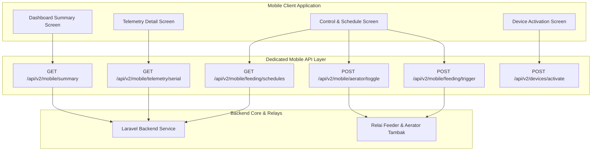

# Lobsense V2 - Mobile Application

Repositori ini berisi kode sumber aplikasi Android dan iOS **Lobsense V2.0** berbasis **Flutter** yang dirancang untuk pengawasan lapangan, pengontrolan relai pakan/aerator, pemantauan indikator sensor, dan aktivasi perangkat di lokasi tambak.

---

## 1. Arsitektur Komunikasi & Mobile Dedicated API

Aplikasi seluler terhubung ke Backend melalui kelompok **Dedicated Mobile API (`/api/v2/mobile/*`)** yang dioptimalkan untuk transmisi data hemat bandwidth pada jaringan seluler 3G/4G:



---

## 2. Pemetaan Fitur Layar Mobile ke Endpoint API Backend

Tabel berikut menunjukkan pemetaan antara layar antarmuka aplikasi seluler dengan endpoint Backend API V2:

| Fitur / Layar Mobile | File Komponen / Screen | Endpoint API Backend | Deskripsi Fungsi |
| :--- | :--- | :--- | :--- |
| **Dasbor Utama Mobile** | `HomeScreen.dart` | `GET /api/v2/mobile/summary` | Menyajikan profil user, total node aktif, cuaca BMKG lokal, dan telemetri node utama dalam 1 payload teragregasi. |
| **Detail Telemetri Node** | `TelemetryDetailScreen.dart` | `GET /api/v2/mobile/telemetry/{serial_number}` | Menampilkan bacaan sensor real-time, grafik tren ringan, ambang batas aman, dan 3 log pakan terakhir. |
| **Jadwal & Log Kontrol** | `ControlScreen.dart` | `GET /api/v2/mobile/feeding/schedules` | Mengambil daftar jadwal pakan otomatis, status sakelar aerator, dan riwayat aktivitas 15 pakan terakhir. |
| **Sakelar Manual Aerator** | `AeratorToggleModal.dart` | `POST /api/v2/mobile/aerator/toggle` | Mengabaikan mode otomatis dan menyalakan/mematikan aerator secara manual dengan timer durasi N menit. |
| **Pakan Instan Dispenser** | `InstantFeedButton.dart` | `POST /api/v2/mobile/feeding/trigger` | Mengirimkan sinyal relai darurat untuk mengaktifkan dispenser pakan instan selama N detik. |
| **Simpan Jadwal Pakan** | `AddScheduleModal.dart` | `POST /api/v2/mobile/feeding/schedule` | Menambahkan jadwal dan durasi pakan otomatis baru dari aplikasi mobile. |
| **Aktivasi Perangkat** | `ActivationForm.dart` | `POST /api/v2/devices/validate-serial`<br/>`POST /api/v2/devices/activate` | Mengambil foto alat dan tanda tangan digital serah terima di lapangan untuk aktivasi IoT Node / Edge Gateway baru. |

---

## 3. Spesifikasi Teknologi Mobile

- **Framework Core**: Flutter 3.24+ (Dart 3.5+)
- **UI Design System**: Material Design 3 Custom Lobsense Theme
- **State Management**: Clean Architecture (MVC / Provider Pattern)
- **HTTP Client**: `http` / `dio` (dengan penanganan token otentikasi Bearer Sanctum)
- **Persistence**: `shared_preferences` & `flutter_secure_storage`
- **Charts & Visualization**: `fl_chart` (Grafik telemetri sensor mobile)

---

## 4. Panduan Compiling & Production Build (Android & iOS)

### 4.1 Prasyarat Lingkungan
- Flutter SDK `>= 3.24.0`
- Android Studio / Xcode
- Android SDK & Java Development Kit (JDK 17)

### 4.2 Perintah Build & Run

```bash
# 1. Masuk ke direktori MobileApp
cd MobileApp

# 2. Ambil paket dependensi Flutter
flutter pub get

# 3. Jalankan aplikasi pada perangkat Android / Emulator
flutter run

# 4. Melakukan kompilasi paket APK rilis Android
flutter build apk --release
```

File APK produksi akan tersedia di direktori:
`MobileApp/build/app/outputs/flutter-apk/app-release.apk`.
